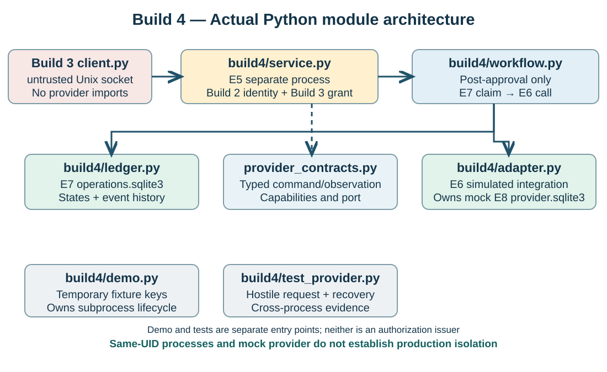
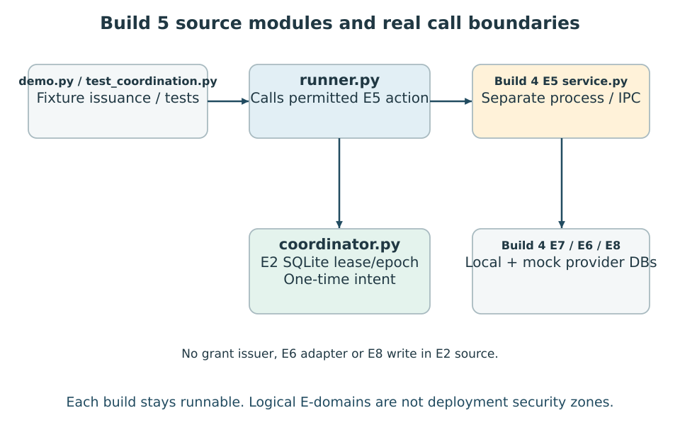

# Companion source architecture — Builds 0–5

The reference architecture names nine logical enterprise responsibilities (E1–E9) and cross-domain contracts (C01–C09); neither identifier range dictates a nine-service deployment. See Chapter 8 for the complete definitions. Here, durable operational state (E7) is the local SQLite operation ledger, while the authoritative business-system responsibility (E8) is represented only by a **simulated** payment-provider SQLite record.

## Build 0 architectural scope (read with Chapter 22)

Build 0 illustrates selected logical responsibilities, **not nine production services**. Figure 22.1 shows trust boundaries and Figure 22.2 shows local operation-state transitions; their canonical SVG masters live in `assets/shared-figures/sources/`.

| Domain | Present educational mechanism | Not demonstrated |
|---|---|---|
| E1 | Fixed trusted case/principal inputs | Real authentication or delegation |
| E2 | Sequential CLI | Distributed ownership, leases and fencing |
| E3/E4 | Absent | No agent, retrieved context or model authority |
| E5 | `authorize()` deterministic fixture rule | Protected policy service, real human approval |
| E6 | In-process provider simulator | Network adapter, secrets and provider guarantees |
| E7 | `operations.sqlite3` local state | Authoritative financial truth |
| E8 | `provider.sqlite3` simulated provider | Real payment-provider effects |
| E9 | Automated fixture tests | Full production assurance |

C01, C02 and C05–C09 are illustrated only in a bounded, partial way; C03/C04 are absent. RF-1042 may be created only after the trusted policy check. A local UNKNOWN means the application does not know the provider outcome; it does not grant permission to retry under a new identity.

The scenario-to-observable-evidence matrix is in `TESTING.md`. The complete architecture is described in Chapter 8 and the book's appendix. Do not mistake this fixture for secure credential isolation, an authenticated service boundary, a tested idempotency contract, or production-ready concurrency.

## Important implementation boundary after the Chapter 22 hardening pass

Build 0 now atomically claims the local E7 `AUTHORIZED → DISPATCHED` transition using a conditional SQLite update. This prevents two *local* callers from winning the same state claim. It is **not** E2 distributed lease/epoch fencing, a protected E5 service, or an E6 provider-specific idempotency guarantee. A simulated provider-unavailable event intentionally leaves E7 `DISPATCHED` and mock E8 empty; only reconciliation or human investigation is permitted, never a blind resend. See `ENGINEERING_STANDARD.md` before adding Builds 1–5.

## Build 1 — advisory-only E3/C04 extension

The C02-like `WorkRequest` remains fixed fixture input (not authenticated E1). E3's `advise()` consumes one explicitly supplied E4-like `Evidence` value; neither retrieval nor its `verified` test bit provides production provenance. `Proposal` is an immutable, schema-checked **C04 untrusted proposal** with an `ADV-` proposal ID and a `TRACE-` correlation ID. Neither is the trusted RF-1042 financial operation identifier. E5 / C05 independently owns authorization and E7 / C06 owns durable consequential intent; Build 1 has no E5/E6/E7/E8 dependency or financial privilege. The optional `CandidateModel` interface returns raw data to a strict parser. A Python source-file boundary is not a hostile-runtime security boundary. Figure 23.1 and `build1/README.md` document the deliberate gaps and future owners.

## Build 2 — E1 identity and E4/C03 context before E3 advice

Chapter 24 / F24-01 separates issuer claims, verified **fixture** scope, scoped E4 catalog observation and untrusted E3/C04 recommendation. `build2/identity.py` verifies a canonical HMAC assertion with expiry and a fixed purpose; `context.py` applies tenant/case/source/classification/freshness checks through a controller-preselected C03-style query (not a literal E3->E4 invocation); `pipeline.py` adapts the result to the unchanged Build 1 `WorkRequest`/`Evidence`. No Build 0 payment imports or E7/E8 database writes appear. `TRACE-204` and `ADV-TRACE-204` remain advisory identifiers, not trusted RF-1042. A `VerifiedScope` instance and the signing key are **not** protected against hostile code running inside this Python process. Missing protections: real authentication and resource-policy enforcement (E1/E4 owners), isolated E5 authorization (Build 3), provider reconciliation (Build 4), and optional E2 fencing (Build 5). Inspect `build2/README.md`, the Figure 24 trio and `TESTING.md` before inferring assurance.

## Source-level architecture views — Builds 0–5

Each build README embeds its checked-in `architecture.svg`: [`build0/architecture.svg`](build0/architecture.svg), [`build1/architecture.svg`](build1/architecture.svg), [`build2/architecture.svg`](build2/architecture.svg), [`build3/architecture.svg`](build3/architecture.svg), [`build4/architecture.svg`](build4/architecture.svg), and [`build5/architecture.svg`](build5/architecture.svg). The [implementation-to-evidence map](IMPLEMENTATION_EVIDENCE_MAP.md) distinguishes the logical architecture path from the runnable Build 5 path and maps negative tests and omitted guarantees. These show *actual Python modules and fixture stores*, not ETIS reference architecture's required physical deployment layout. They must be inspected and updated with code changes.

### Build 3 — separately executed trusted-execution (E5) request gate

Chapter 25 and F25-01/02/03 add a distinct E5 service process (`build3/service.py`) using a bounded Unix socket exposed by `build3/client.py`. The trusted-execution service (E5) checks a **valid admission-and-identity (E1) fixture assertion** independently of a second, short-lived, transaction-specific finance approval before creating RF-1042 through the Build 0 trusted fixture adapter. A valid agent identity token is insufficient. On approval E5 calls `refund.prepare()` (E7 durable operation intent) **before** `refund.dispatch()` (E7 claim then mock E8 effect). Transport parsing has a total framing deadline and peer-disconnect containment, but the single-worker fixture is not a flood-resistant service. E7 and mock E8 are inaccessible through the *client API* and remain separate server-owned SQLite files. The demo still runs both processes under the **same OS user**: this does not protect keys or files from arbitrary same-user host code. Real E5 credential custody/independent OS identity and real E1/E4 protection require production deployment enforcement, not Python module names. Provider integration/reconciliation belongs to Ch26; optional E2 fencing to Ch27; broader compromised-agent verification to Ch29/31.

## Build 4 — Provider integration and reconciliation (Chapter 26)

Build 4 retains the **independently checked E5 request-path service**, reusing Build 2 E1 fixture identity and Build 3 transaction-specific finance approval. After the E5 decision, `build4/workflow.py` commands the local **E7/C06** `ledger.py` to persist RF-1042 and an ordered, transactional local `operation_events` history, then claim one dispatch before `adapter.py` exercises the **E6/C07** pinned provider protocol. `provider_contracts.py` supplies typed provider commands, capabilities, and **E8/C08** status observations; the mock E8 system is a separate SQLite database. The reconciliation path performs status reads only. `build4/demo.py` and `test_provider.py` are separate entry points, not an authorization issuer or independent platform component. This maps logical responsibilities to actual modules without asserting real payment-provider guarantees, hostile same-UID isolation, or multi-worker E2 fencing. See [Build 4 README](build4/README.md) for constraints and executed tests.

## Build 5 — Optional E2 coordination and ownership (Chapter 27)

`build5/coordinator.py` owns **only E2/C02** local durable work identity, a SQLite transactional lease, increasing epoch and one-time execute-intent decision; `runner.py` delegates its single selected `execute` or status-only `reconcile` action to the unchanged Build 4 E5 socket. E5 still validates E1 identity and an independent case-specific finance grant before E7 claim and E6/mock E8 work. A valid E2 lease is **not** an E5 authorization, and an E2 `CONFIRMED` is not direct provider proof. Build 5 fences E2 database mutation, **not E5 execution by stale workers**; full distributed fencing, protected service principals, independent reconciliation roles and real provider verification remain outside the educational fixture. See [Build 5 README](build5/README.md) for exact code, evidence and omissions.

## Chapter 30 operations observer

The separate `operations/` directory has a README-embedded source/module `architecture.svg`, `incident.py` and 14 tests. It observes Build 5 E2 and Build 4 E7 persistent state without importing E5/E6 effect interfaces. Synthetic E8 evidence is a parameter, never authoritative financial proof; `Finding` is an E9-oriented operator recommendation, not a grant or C07 command. See Chapter 30 Figure 30.1 and `IMPLEMENTATION_EVIDENCE_MAP.md`.

## Chapter 31 non-effectful assurance collector

[`assurance/architecture.svg`](assurance/architecture.svg) is embedded in [`assurance/README.md`](assurance/README.md) and maps the actual `collect.py` fixed registry to existing `security/`, `reliability/`, `build4/`, `build5/` and `operations/` test modules. Its output is a versioned local JSON record and source digests, not a C07 dispatch, protected C09 audit, independently signed provenance or authorization. There is no progressive Build 6. Chapter 31 retains production stop conditions: E5 does not verify Build 5 epochs, provider settlement is simulated, credential custody is not host-isolated and E9 audit is not tamper-evident.
