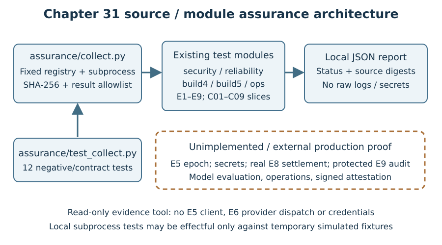

# Chapter 31 — reproducible assurance evidence (not Build 6)

This is a **small, read-only evidence-collection layer** over the **actual, independent** Build 4/5, Chapter 28 recovery, Chapter 29 security and Chapter 30 incident tests. It does not add an agent, payment command, credential, provider connection or privileged execution path. Its job is to make the difference between **what ran**, **what passed**, **what was simulated**, and **what production acceptance still requires** explicit enough for an engineer to review.



## Reproduce from the repository root

First run the collector's own 16 negative/contract tests:

```bash
python3 -m unittest discover -s examples/refund-reference-system/assurance -p 'test_*.py' -v
```

Then run seven **exact named methods** across prior fixtures; the output JSON is intentionally placed **outside this repository**. Substitute a unique path if it already exists (the collector will not overwrite evidence):

```bash
python3 examples/refund-reference-system/assurance/collect.py --output /tmp/etis-ch31-evidence.json
```

The command exits `0` only when all seven registered local methods pass and the runner observes **exactly one executed test** for each. Exit `1` indicates an executed failure, timeout or missing test; exit `2` indicates unusable evidence inputs or output. The output is versioned JSON with UTC timestamp, Python runtime, registered claim, exact method, narrowly scoped claim and exclusion, source SHA-256, exit/result count, and a SHA-256 of subprocess output. It does not include raw test stdout/stderr or untrusted payloads.

**Do not commit the locally produced evidence JSON as a universal pass result.** It is tied to the execution environment and timestamp. Its hashes establish byte identity, not process attestation, complete provenance, secrecy or independent audit custody. Verify the local source checkout and repeat the run. This code uses Python's built-in `unittest` and standard library; it never issues a real payment.

## Exact test and educational claim map

| Registry claim | Existing source/test invoked | Lesson and limitation |
|---|---|---|
| `AUTH_DENIAL` | `../security/test_adversarial_cases.py`, `HijackedInvestigatorAgainstRealE5.test_valid_identity_without_finance_grant_denied_without_effect` | A valid scoped investigator identity does not grant finance authority; same-UID keys and process custody remain unprotected |
| `WRONG_PROOF` | `../reliability/test_recovery_cases.py`, `RecoveryTests.test_wrong_operation_proof_escalates` | Wrong RF-1042 identity is no proof of original refund; mock E8, not external settlement |
| `NOT_FOUND` | Same file, `RecoveryTests.test_not_found_never_declares_failure` | Missing provider observation cannot justify new effect |
| `NO_REPLAY` | `../build4/test_provider.py`, `Build4Test.test_replayed_execute_does_not_call_provider_twice` | Existing E7/fixture E8 path suppresses replay under local assumptions |
| `STALE_OWNER` | `../build5/test_coordination.py`, `CoordinatorTests.test_stale_owner_cannot_override_new_owner_reconcile` | E2's own epoch writes are fenced; **E5 has not checked the epoch** |
| `READ_ONLY` | `../operations/test_incident.py`, `IncidentTests.test_lost_ack_unknown_with_confirmed_synthetic_e8_still_requires_review` | Read-only classification avoids new local effect; no protected audit custody |
| `TELEMETRY_GAP` | Same operations file, `IncidentTests.test_missing_telemetry_never_closes_case` | Missing event remains unresolved; synthetic collector has no production delivery assurance |

## Read the code by responsibility

- `collect.py`: `FixtureCase` registry and non-guarantee statements, `validate_registry` path/existence gate, `run_case` strict unittest result/timeout handling and stdout/stderr hashing, `collect` versioned report, `main` fail-closed CLI. **No dynamic shell command or arbitrary user-selected source/test.**
- `test_collect.py`: deliberately malformed input, missing test module, unsafe `../` escape, duplicated claims, missing/unexpected test count, timeout, unavailable Python, output secret omission and fixture source digest checks. The mocked subprocess in these tests is *not* evidence that the seven real methods executed; use `collect.py` separately.
- `../operations/incident.py`: Chapter 30 non-effectful observer; `../build4/ledger.py`: local E7 history; `../build4/adapter.py`: simulated E8; `../build5/coordinator.py`: local E2 epoch; `../security/test_adversarial_cases.py`: actual Build 3 E5 process denial.

## Reproduce a negative result deliberately

Copy this directory into a disposable scratch location with its dependencies, or use the unit test `test_missing_test_module_fails_closed`; a nonexistent method cannot produce a passing claim. `test_timeout_fails_without_output` shows timeout status remains `EXECUTED_FAIL` and cannot leak fixture output to the JSON. The registry is source-controlled and intentionally immutable at runtime. A SHA-256 of the output does not prove that an attacker could not alter both output and hash.

## Production stop conditions

The exported `production_gaps` always retain `E5_EPOCH`, `CREDENTIAL_CUSTODY`, `PROVIDER_SETTLEMENT`, `PROTECTED_AUDIT`, and `AGENT_EVALUATION`; they do **not** flip to `EXECUTED_PASS` when fixtures are green. An independent production release authority must inspect real E5 owner fencing, protected issuer/key custody, specific provider settlement/idempotency/status contracts, E9 evidence custody, representative agent evaluation, runbooks and recovery exercises. Chapter 31 Table 31.1 and Figure 31.3 explain why a safety-critical absence is a **no-go**, not an extra item in a weighted score. Readers should also review [`../ASSURANCE_HANDOFF_CH28_CH31.md`](../ASSURANCE_HANDOFF_CH28_CH31.md) and [`../IMPLEMENTATION_EVIDENCE_MAP.md`](../IMPLEMENTATION_EVIDENCE_MAP.md).
