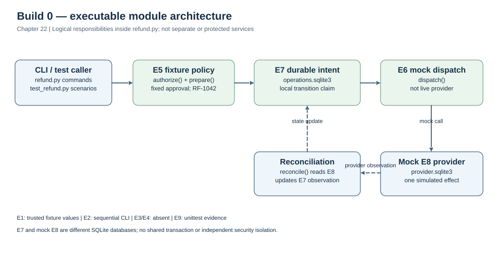

# Build 0 — Deterministic Refund Baseline

**Chapter 22 hands-on exercise.** The reference fixture is **not** a production payment service. It uses Python's standard library only and never sends money or uses credentials.

## Implementation architecture



This is a **module-and-data view**, not a deployment diagram. `refund.py` contains the E5 policy fixture, E6 simulated adapter, and E7 persistence logic. The separate simulated E8 SQLite file does not establish a real payment-provider guarantee. The diagram source is [`architecture.svg`](architecture.svg), maintained with this build and independently readable in GitHub or offline Markdown renderers. Follow the book's Chapter 22 figures for the **logical enterprise architecture**; this drawing maps that design to actual educational source files.

## Inspect the files

- `refund.py` — fixed CASE-204 / $500 (50000 integer cents) / RF-1042; trusted fixture approval, durable local intent, mock provider dispatch and reconciliation.
- `test_refund.py` — self-contained unittest scenarios using temporary databases, including two-caller contention, malformed input, provider unavailability and denial behavior; `../TESTING.md` maps each scenario to observed evidence.
- E7 local status: `operations.sqlite3`; simulated E8 payment truth: `provider.sqlite3`. These are two different SQLite files, **not** a distributed transaction.

The fixed `approved` flag is not a real human-approval system. The provider's unique operation key models a fictional contract, not a verified live-provider guarantee.

## Exercise 1 — run the negative and recovery tests

From the repository root:

```sh
python3 -m unittest discover -s examples/refund-reference-system/build0 -p 'test_*.py' -v
```

Expected: all discovered tests passing (the count can grow as coverage improves). Read the test names and assertions, especially the wrong-tenant, duplicate-dispatch, lost-acknowledgment, missing-provider and conflicting-provider tests. Passing them demonstrates only the tested fixture behavior.

## Exercise 2 — compare E7 and E8 after a lost acknowledgment

Use a **fresh** disposable demo directory (for example, change the path below if `/tmp/etis-build0-demo` already exists). Run these in order from the repository root:

```sh
python3 examples/refund-reference-system/build0/refund.py prepare --directory /tmp/etis-build0-demo
python3 examples/refund-reference-system/build0/refund.py dispatch-lost-ack --directory /tmp/etis-build0-demo
python3 examples/refund-reference-system/build0/refund.py status --directory /tmp/etis-build0-demo
```

At this point E7 reports **UNKNOWN**, even though mock E8 has one RF-1042 **CONFIRMED** row. Inspect the two databases with Python (no SQLite CLI required):

```sh
python3 - <<'READ_ONLY_DEMO'
from pathlib import Path
import sqlite3
folder = Path('/tmp/etis-build0-demo')
for label, filename, table in [('E7 local','operations.sqlite3','operations'),
                               ('E8 mock','provider.sqlite3','refunds')]:
    with sqlite3.connect(folder / filename) as db:
        print(label, db.execute('SELECT * FROM ' + table).fetchall())
READ_ONLY_DEMO
```

Then reconcile under the **same operation identity** and inspect again:

```sh
python3 examples/refund-reference-system/build0/refund.py reconcile --directory /tmp/etis-build0-demo
```

| Observation | E7 local operation | Mock E8 provider |
|---|---|---|
| After `prepare` | AUTHORIZED | No refund row |
| After `dispatch-lost-ack` | UNKNOWN | RF-1042 CONFIRMED |
| After `reconcile` | CONFIRMED | Same RF-1042 CONFIRMED |

The CLI prints local E7 status only. A real provider's absence or contradictory response would leave the outcome unresolved; it would **not** permit a new $500 refund.

## Exercise 3 — judgment and limitations

Explain why wrong-tenant or missing approval cannot create E7 intent; why a timeout does not mean FAILED; why repeating dispatch after UNKNOWN is prohibited; and what external-provider contract evidence would be needed to claim a live refund occurred.

**Test evidence and scope:** See `../TESTING.md` for the scenario matrix and reviewer workflow. **Not demonstrated:** concurrent workers, E2 owner fencing, secure E5 isolation, live E1 authentication, credentials, network error models, full E9 audit evidence, or real-world idempotency. Never attach this fixture to a payment service. Use a fresh demo directory each time and delete only the disposable files you created. Chapter 23 will add advisory interpretation *without* payment authority.

## Exercise 4 — provider unavailable *before* its mock commit

Use a fresh disposable directory distinct from the prior exercise:

```sh
python3 examples/refund-reference-system/build0/refund.py prepare --directory /tmp/etis-build0-unavailable
python3 examples/refund-reference-system/build0/refund.py dispatch-provider-unavailable --directory /tmp/etis-build0-unavailable
python3 examples/refund-reference-system/build0/refund.py status --directory /tmp/etis-build0-unavailable
python3 examples/refund-reference-system/build0/refund.py reconcile --directory /tmp/etis-build0-unavailable
```

The second command intentionally exits **2** and prints a bounded `PROVIDER_UNAVAILABLE` error on stderr. E7 remains `DISPATCHED` because it committed the dispatch claim before the simulated failure; mock E8 has no row. Reconciliation returns `UNKNOWN` as an observation, but the last persisted E7 state stays `DISPATCHED` pending investigation. A direct retry of `dispatch` is denied. This is conservative: **absence of a provider row is not a guarantee that a live provider never acted**.

## What counts as professional code here?

The fixture now closes its SQLite connections, validates monetary and approval types, uses an atomic local dispatch claim, and returns a controlled CLI error for expected denials and availability failures. These are executable safety lessons, not a claim of production readiness. The code intentionally omits real identity proof, process-isolated E5 controls, provider credentials, distributed coordinator leases, hardened telemetry, schema migrations and external idempotency-contract verification. See [`../ENGINEERING_STANDARD.md`](../ENGINEERING_STANDARD.md) for the required architecture, error, security and QA standards for future builds. For this educational artifact, leaving such mechanisms explicitly unimplemented is more accurate than adding mock components that look secure but aren't.
