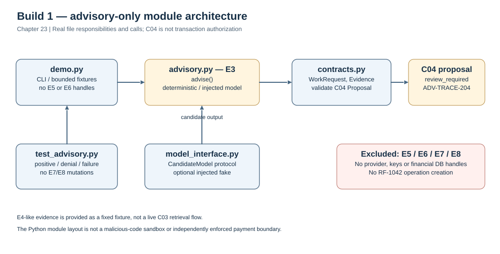

# Build 1 — bounded advisory reasoning (Chapter 23)

**No payment is issued by these commands.** Build 1 is a standard-library-only, Python 3.10+ deterministic advisory fixture for fictional `CASE-204`, a potential **$500** (`50000` cents) refund. `RF-1042` remains the separately controlled Build 0 consequential-operation identity; neither `TRACE-204` nor `ADV-TRACE-204` is authorization, an idempotency key, or a payment operation.

From the repository root:

```sh
python3 examples/refund-reference-system/build1/demo.py
python3 examples/refund-reference-system/build1/demo.py --delivery delivered
python3 examples/refund-reference-system/build1/demo.py --delivery unknown
python3 examples/refund-reference-system/build1/demo.py --inject
python3 -m unittest discover -s examples/refund-reference-system/build1 -p 'test_*.py' -v
python3 -m unittest discover -s examples/refund-reference-system/build0 -p 'test_*.py' -v
```

Expected first run: JSON object with `untrusted_proposal.disposition` = `RECOMMEND_REVIEW`, `review_required` = `true`, `financial_effects` = `0`, `authorization` = `NOT_GRANTED`. Delivered yields `DO_NOT_RECOMMEND`; unknown yields `INSUFFICIENT_EVIDENCE` and `UNRESOLVED` uncertainty. `--inject` adds adversarial prose to the inert evidence narrative: the resulting outcome is unchanged. None of these commands creates SQLite files. No credentials, `pip`, model service or network are required. Tests use temporary databases where applicable.

## Source-code architecture diagram



This version-controlled diagram maps the teaching modules to logical enterprise responsibilities (E1–E9) and cross-domain contracts (C01–C09), as defined in Chapter 8; it does **not** establish an independently protected security boundary. Read the module names, implementation limitations, and executable tests together. Changes to source interfaces or trust boundaries require changing this SVG in the same patch.

## Guided source-reading checkpoint

Follow one fixed CASE-204 request rather than reading the files alphabetically:

1. Start in `demo.py:main` to see the fictional evidence and optional injection switch.
2. Inspect `contracts.py:WorkRequest`, `Evidence`, `Proposal.parse`, and `validate_proposal`. Ask why extra fields and Boolean money are rejected instead of coerced.
3. Read `advisory.py:advise` and `model_interface.py:CandidateModel`. The candidate proposes C04 data; it never obtains E5/E6 tools.
4. Run `test_advisory.py:test_adversarial_narrative_is_inert`, then `test_e7_e8_unchanged_and_no_operation_creation` to falsify the claim that prose can authorize a payment.

**Explain the result:** A syntactically valid, scope-matched recommendation remains untrusted. The lesson is *independent business authorization*, not model accuracy or how to call a vendor API.

## Read the implementation in control order

1. `contracts.py`: exact `WorkRequest`, `Evidence` and `Proposal` typed contracts. All money uses integer cents and rejects `bool` and `float`; case/tenant/schema/freshness are bounded to fixed fixtures. `Proposal.parse()` rejects unexpected fields such as `approved` and `provider_key` rather than silently ignoring them.
2. `model_interface.py`: replaceable `CandidateModel` protocol accepts only scoped work/evidence and returns untrusted data; it has no payment tools, client or credentials.
3. `advisory.py`: deterministic candidate generation and independent proposal validation. All recommendations require review. Missing evidence never becomes approval; dependency failure raises `AdvisoryUnavailable` instead of falling back into execution.
4. `demo.py`: the `E3/C04` path. Its JSON is demonstration output, **not** audit-grade E9 telemetry. It does not call Build 0.
5. `test_advisory.py`: positive/negative tests, malformed payloads, forged permission, hostile narrative, model failures, scope mismatch and no-state-change checks.

## Important distinctions

| Fixture feature | Actually demonstrated | NOT proven; owner / risk / later evidence |
|---|---|---|
| WorkRequest | Fixed case/tenant/amount bound | E1 authentication, impersonation resistance; Chapter 24/25 negative token tests |
| Evidence | Fixed source, version and verified fixture bit | E4 retrieval authorization, freshness of live facts, provenance integrity; Chapter 24 malicious/stale-source tests |
| Proposal | Untrusted C04 schema, strict parser, independent correlation | E5 policy or human authorization; Chapter 25 isolated enforcement and valid-token denial |
| No payment imports | Advisory path cannot accidentally invoke the provided Build 0 API | Hostile code in a shared Python process is **not sandboxed**; Chapter 25 process/key isolation and attack testing |
| No E7/E8 writes | No databases in advisory API; tests check unchanged stores | Distributed coordination, database permissions and real provider scope; Chapters 25–27 enforcement/containment evidence |
| Errors | Malformed model data rejected, exceptions mapped to unavailable | Availability SLA, retries, telemetry security, drift monitoring; Chapters 27, 30–31 verification |

**Malformed nested data:** The C04 parser rejects nested, non-string source identifiers as `InvalidAdvisory` rather than allowing a raw Python collection error. This is a schema-denial result, not a financial authorization or provider failure.

**Failure handling:** `InvalidAdvisory` means a schema/scope/evidence failure; `AdvisoryUnavailable` means an injected model failed. Never interpret either as a declined payment or a safe reason to try a new refund. The code intentionally does not supply a model SDK. The model protocol exists solely to enable contract tests and a later isolated adapter.

**Student exercise:** Modify a fake model to return `approved: true`, `proposal_id: RF-1042`, a different tenant, or an invented source. Show the exception and prove the existing Build 0 `RF-1042` path is not invoked. Then compare decisions under false/true/unknown delivery evidence and explain when advice adds measurable value over Design A. Finally run the independent Build 0 lost-acknowledgment scenario and explain why it still needs reconciliation.

**Debugging and safe cleanup:** Errors surface as a nonzero exit code in the CLI; tests print individual method names. If `ModuleNotFoundError` occurs, run `demo.py` directly as shown, not `python -m build1` from another folder. Build 1 produces no persistent files to clean; temporary test stores are deleted automatically. Build 0's persistent demonstration files, if you previously created any, must be removed only after inspecting their E7/E8 contents and confirming they are disposable fixture files.

**Next build:** Chapter 24 adds validated E1 and E4 context boundaries. It must not retroactively claim that this single-process teaching fixture establishes secure identity, evidence provenance or privileged separation. Edition reproducibility requires the book's immutable release tag; mutable `main` is not a publication lock.
