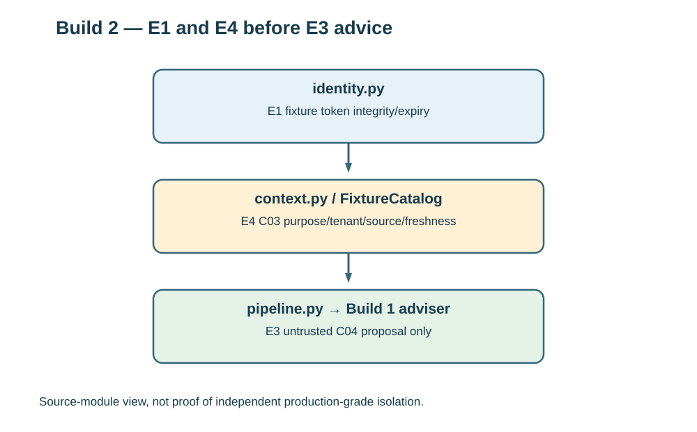

# Build 2 — Scoped identity and context (Chapter 24)

**Start here after reading `../ENGINEERING_STANDARD.md` and Chapters 22–24.** This is an executable, credential-free educational fixture. It is not an identity provider, a payment service, an isolated policy enforcement point or a tool capable of transferring money. Uses Python 3.10+ standard library, with no network, `pip` installation, credentials or external provider.

## Source-code architecture diagram



This version-controlled diagram maps the teaching modules to logical enterprise responsibilities (E1–E9) and cross-domain contracts (C01–C09), as defined in Chapter 8; it does **not** establish an independently protected security boundary. Read the module names, implementation limitations, and executable tests together. Changes to source interfaces or trust boundaries require changing this SVG in the same patch.

## What this increment adds

Build 0 independently demonstrates local financial intent/reconciliation. Build 1 independently produces C04 untrusted advice from a fixed evidence object. Build 2 deliberately composes E1 claim integrity and E4/C03 scoped provenance *before* calling the unchanged Build 1 E3 adviser. The flow is `fixture assertion -> E1 verify -> scope gate -> E4 catalog retrieve -> Build 1 advise -> untrusted C04 review result`. The fixture controller prefetches a C03-like response **on behalf of E3** so the exercise can verify source controls without introducing dynamic tool selection; this is not a literal E3-to-E4 query protocol or a complete C01/C02 workflow. Missing C01 workflow ID, risk tier, policy version and deadline need independent E1/E2 ownership in a real deployment. It never calls the Build 0 refund module, financial database or E6 adapter. CASE-204 / `retailer_a` / USD 50,000 cents are fixed teaching facts. `TRACE-204` and `ADV-TRACE-204` are correlation and proposal identifiers, **not** RF-1042.

| File | Responsibility |
|---|---|
| `identity.py` | Strict fixture assertion contract, canonical HMAC signature and expiry verification; `VerifiedScope` |
| `context.py` | Read-only fixture catalog, tenant/case/source allowlist, observation age, classification and provenance |
| `pipeline.py` | Adapter to unchanged Build 1, no effect path; returns `ReviewResult` |
| `demo.py` | Deterministic positive, abuse, stale and dependency-outage CLI scenarios |
| `test_scope.py` | 13 isolated tests for integrity, scope, freshness, failure and no financial writes |

## Run from the repository root

```sh
python3 examples/refund-reference-system/build2/demo.py
python3 examples/refund-reference-system/build2/demo.py \
  --scenario injected
python3 examples/refund-reference-system/build2/demo.py \
  --scenario cross-tenant
python3 examples/refund-reference-system/build2/demo.py \
  --scenario stale
python3 examples/refund-reference-system/build2/demo.py \
  --scenario forged
python3 examples/refund-reference-system/build2/demo.py \
  --scenario outage
python3 -m unittest discover \
  -s examples/refund-reference-system/build2 \
  -p 'test_*.py' -v
```

Expected: default and `injected` exit 0 and print `ADVISORY_ONLY`, `RECOMMEND_REVIEW`, `financial_effects: 0`, `authorization: NOT_GRANTED`, with `EV-204` and 60-second observation age. The four negative scenarios exit 2 with `DENIED_OR_UNAVAILABLE`, `ScopeDenied` or `ContextUnavailable`. Exit 2 is expected for the **negative** examples. Tests have no external dependencies. Run `build1/test_advisory.py` and `build0/test_refund.py` independently using their own READMEs. Do **not** run the installer or delete any repository files as part of this example.

## Understand the security limitations before interpreting results

- The key in `demo.py` is **public fixture data**. This HMAC exercise illustrates signature integrity; it does not establish that a real human, organization or agent was authenticated. A hostile process can import the issuer or forge a claim with the known key. A `VerifiedScope` object is locally constructible and is not an unforgeable capability.
- `FixtureCatalog` is an in-process mapping. Its source identifiers, observation age, `CASE_RESTRICTED` label and `provenance` text are simulated. They do not prove external origin, independently authorized data access, confidentiality, durable revocation, cache invalidation, policy correctness, or current E8 payment truth.
- The record's customer narrative is untrusted prose, even when the catalog record has a valid fixture timestamp. The deterministic E3 adviser ignores the instruction content; **a live model could behave differently** and must receive separate adversarial evaluation.
- A valid fixture identity assertion cannot authorize a $500 transaction. Build 2 has **no E5/E6 privileges**; code separation and unchanged-database tests prove only that these entry points have no effect, not that a malicious Python interpreter cannot reach Build 0's in-process functions.
- `ScopeDenied` covers malformed, altered, unauthorized, stale or unsupported requests. `ContextUnavailable` is an E4 outage. Neither changes E7 state to `UNKNOWN`; that term is reserved for unresolved *financial effect* observation in Build 0/Ch22.

## Production gap, owner, and evidence needed

| Omitted mechanism | Owner / later treatment | Associated risk | Acceptance evidence |
|---|---|---|---|
| Independent identity proofing, key custody, issuer/audience binding, replay and revocation | E1 platform; production deployment / Ch25 boundary demonstration | Local assertion can be forged | Protected IdP integration and revoked/stolen-token tests |
| Independent E4 context authorization, source integrity, classification policy, retention | E4 data/platform and E9; later system verification Ch29–31 | Cross-tenant or poisoned retrieval | Boundary denial, source-signature, freshness and audit tests |
| Isolated transaction-specific E5 authorization, provider keys | E5/E6 / Chapter 25 | Agent with valid token could attempt unauthorized $500 refund | Denial at independently checked request path, no RF-1042 or provider effect |
| Real provider integration, idempotency and reconciliation | E6/E7/E8 / Chapter 26 | Duplicate or unknown payment effect | Injected lost-ack/provider-commit tests and reconciliation |
| Durable multi-worker ownership, leases/epochs/fencing | E2/E7 / optional Chapter 27 | Stale worker may act after takeover | Concurrent takeover and stale-owner rejection |

## Exercises and safe diagnostics

Try a different source allowlist; issue a signed `other_tenant` fixture assertion; change `observed_at` by six minutes; inject text that says to issue RF-1042; and force an E4 outage. Predict which function rejects each request. For debugging, inspect `ScopeDenied` versus `ContextUnavailable` category, not secrets or customer narrative. The CLI emits no credentials, private records or exception internals. Python `unittest`'s temporary directories are cleaned by their context managers. Do not interpret `financial_effects: 0` as a query of a real provider.

The next Build 3 adds a **separate-process, independently checked E5 request-authorization gate** (not protection against arbitrary hostile same-user processes). It specifically tests the compromised investigator carrying a valid identity token: authentication cannot substitute for case-specific business authorization.
