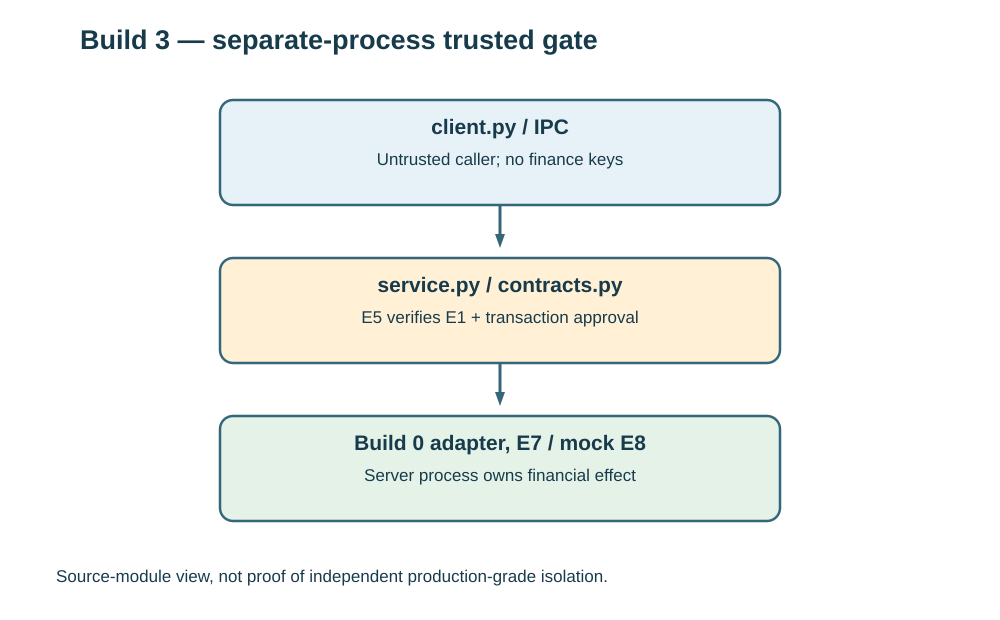

# Build 3 — Separate-process E5 request-authorization gate (Chapter 25)

**Teaching checkpoint, not a certified payment service.** This is a separate-process **request-path** enforcement exercise, not protection against arbitrary hostile code under the same OS user. Trusted execution and authority (E5) checks admission-and-identity (E1) fixture assertions and separately signed transaction-specific approvals; an advisory action proposal (C04) grants neither authority nor provider access. Read [Chapter 25](../../../manuscript/part-04-implementation/ch25-build-3-trusted-consequential-execution/index.md), [ETIS reference architecture's book mapping](../ARCHITECTURE.md), [engineering standards](../ENGINEERING_STANDARD.md), and [test evidence](../TESTING.md) alongside this implementation. CASE-204 remains a proposed **$500 / 50,000-cent** refund; only an independently approved E5 request can create operation **RF-1042**. Build 3 does not require Design C or a live AI model.

## Source architecture (actual modules, not production deployment assurance)



| Module | Role and contract | Must not be interpreted as |
|---|---|---|
| `client.py` | Request transport over Unix socket; C05-like E3-to-E5 request only | Business authorization, ownership of E6 or grant key |
| `contracts.py` | Strict typed shape, canonical signed approval, E5 policy fields | Independent finance issuer or production key manager |
| `service.py` | Separate process: verifies E1 fixture assertion, validates signed E5 grant, owns E7/E6 mock adapter | Distinct OS principal, hardened application sandbox or live provider integration |
| `demo.py` | Temporary fixture keys, local subprocess, approved/attack/outage exercises | Secure issuance or confidential approval workflow |
| `test_gate.py` | Direct process-boundary negative and replay tests | Protection against arbitrary same-UID host code |

`service.py` imports existing `build0/refund.py` only on the *server side*. The client module cannot import a privileged E6 interface through its own intended call graph. `service.py` explicitly verifies the existing Build 2 `LocalAssertionAuthority` contract, while the demo uses a uniquely generated fixture key to obtain a genuinely valid E1 assertion. The **separate signed transaction approval** has different claims and a different key from the E1 assertion. The E5 grant **does not** originate from E3/C04, and the E5 process exposes no `approve` endpoint. E7 (`operations.sqlite3`) and mock E8 (`provider.sqlite3`) remain separate, and the server owns their paths. The server calls `refund.prepare()` to commit E7 durable RF-1042 intent **before** `refund.dispatch()` claims the E7 dispatch transition and attempts the mock E8 effect. No direct client-to-adapter call is exposed. E2 fencing and real provider integration are not provided.

## Guided source-reading checkpoint

1. Follow `demo.py:run` to see the temporary fixture keys and the separate E5 subprocess.
2. Read `client.py:request` and `service.py:read_frame` for the bounded Unix-socket message. A transport frame is not an authorization grant.
3. Trace `service.py:execute` and `contracts.py:verify_grant`: E1 identifies the agent; the distinct finance grant authorizes the specific consequence. The service, not the adviser, owns `refund.py` and the two database paths.
4. In `test_gate.py`, compare `test_valid_agent_token_is_not_payment_approval` with `test_authorized_one_effect_and_replay_refused`. Then inspect `test_slow_trickle_does_not_extend_absolute_frame_deadline` for resource-exhaustion containment.

**Explain the result:** A separate process and checked request path are useful teaching boundaries, but the two processes share an OS user. This example does not demonstrate protected key custody or a hardened process sandbox.


## Requirements and execution

Python 3.10+ standard library, macOS/Linux with Unix-domain sockets; no pip dependencies, cloud SDK, credentials, model account or payment provider. From the **repository root**:

```sh
python3 examples/refund-reference-system/build3/demo.py \
  --scenario compromised
python3 examples/refund-reference-system/build3/demo.py \
  --scenario approved
python3 examples/refund-reference-system/build3/demo.py \
  --scenario tampered
python3 examples/refund-reference-system/build3/demo.py \
  --scenario outage
python3 -m unittest discover \
  -s examples/refund-reference-system/build3 \
  -p 'test_*.py' -v
```

| Scenario | Expected status / CLI exit | E7 / mock E8 outcome |
|---|---|---|
| `compromised` | `DENIED` / 2 | Both files absent; real fixture token but no transaction grant |
| `approved` | `CONFIRMED` / 0 | One RF-1042 intent and one mock provider refund |
| `tampered` | `DENIED` / 2 | No intent or provider database |
| `outage` | `UNKNOWN` / 2 | E7 unresolved `DISPATCHED`; no provider effect; **never retry blindly** |

The application exception families are `InvalidRequest`/`AuthorizationDenied` (denied before effect) and `EffectUncertain`/`ServiceUnavailable` (do not infer financial failure). The single-worker E5 socket now uses an **absolute 0.75-second frame deadline**, bounded input, and scoped connection-level receive/send exception handling. A disconnected peer does not kill the E5 process; an incomplete or trickle-fed frame cannot hold its worker indefinitely. A response lost *after* effect execution still means **UNKNOWN to the caller** and must not trigger an automatic retry. These are request-path resilience controls, **not** sustained-load, concurrency or production-availability guarantees. Response bodies contain bounded status categories, not grant keys or financial credentials. A failed CLI scenario exits with a deliberate nonzero status, so run examples individually rather than chaining with `&&`. Test concurrency, replay, malformed JSON, oversized and unfinished frames, slow-trickle clients, aborted connections, wrong-tenant, bool-money, forged approval fields, expired grant and unavailable service with `test_gate.py`. The single-worker design can queue a request for up to a frame deadline per preceding stalled client; no connection-pool scheduling, rate limiter or per-principal admission quotas are implemented.

## Attack path and limits of evidence

The hijacked investigator is assumed to control E3 output and its request fields, possess a valid Build 2 E1 assertion, and reach the E5 Unix socket; it does **not** control the trusted approval issuer or E5 files. The E5 process independently checks the assertion and the transaction grant, and denies a request without the latter. The tests verify the absence of both E7 and mock E8 files after denial. The approved path checks that six concurrent replay attempts produce exactly one confirmed fixture operation.

**This is process separation, not true same-host security isolation.** The demo runs the E3 harness and E5 subprocess under the same local OS user. A malicious arbitrary-code process with the user's file permissions could read local keys or SQLite files and bypass these checks. The socket's mode and a temporary directory do not defend against that adversary. Production requires the E5 and finance issuer to run under distinct service identities with least-privilege filesystem and provider credentials, access-restricted IPC or mutual authentication, secret rotation/revocation and auditable authorization decisions. Do not deploy this demo for real payments.

## Omitted mechanism, owner, risk, and evidence

| Omitted mechanism | Architectural owner / later treatment | Risk | Verification required |
|---|---|---|---|
| Protected identity issuer and context access | E1/E4 platform, deployment assurance | Forged or stolen identity, leaked data | Real IdP, issuer/audience binding, tenant denial and revocation tests |
| Separate finance approval identity, grant custody, replay-use ledger | E5 governance/security; Ch29 and Ch31 verification | Same-UID process could steal or forge fixture grants | OS-level isolation, grant-use audit, independent issuance and hostile-code tests |
| Real external provider secrets, idempotency and reconciliation | E6/E7/E8, Chapter 26 | Unknown or duplicated external financial outcome | Provider contract tests, lost ack/replay/reconciliation evidence |
| E2 durable ownership fencing and failover | E2/E7, optional Chapter 27 | Stale owner may dispatch after takeover | Lease/epoch fencing, failover and crash/restart drills |
| Concurrent admission, rate limiting and resource quotas | E5 service platform; Ch30–31 | A burst of slow clients can accumulate bounded queue delays despite per-client deadlines | Load, saturation, abort, backpressure and denial-of-service tests |
| Operational audit, incident containment and privacy retention | E9 and service operations, Ch29–33 | Insufficient investigative evidence or prolonged incident | Safe structured events, key rotation and incident-runbook exercises |

The current code does **not** implement independently protected OS accounts or real customer/payment services. The socket endpoint is a teaching service, and `simulate_outage` is only a test hook. It deliberately leaves E7 `DISPATCHED` after an injected outage to teach that an uncertain effect is not failed. The next Build 4 adds provider-specific idempotency and reconciliation, not additional authority to E3.

## Maintenance and exercises

Run all Build 0–3 suites independently; preserve their own entry points. Compare approval, identity and correlation IDs before changing any schema. Any change to modules, E1/E5/E6 contracts, E7/E8 stores or trust boundaries must update this README and `architecture.svg` in the same patch. Predict rejection of an `ADV-` proposal embedded as `approval_grant`, then verify no E7 row is created. Design a real OS identity separation and demonstrate that a compromised E3 UID cannot read E5's secret or storage. Do not use `rm -rf` on a repository directory; the demo's temporary fixture directory is cleaned after subprocess termination.
