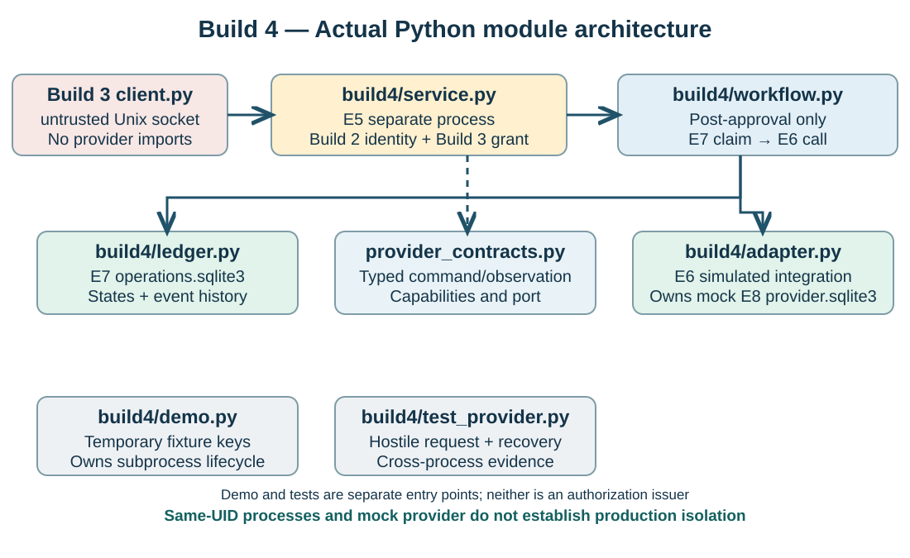

# Build 4 — Provider Integration and Reconciliation (Chapter 26)

**Educational runnable checkpoint — not a payment system.** This directory models a versioned provider contract, a separate mock provider database, durable local operation state and read-only reconciliation behind an E5 request gate. Its purpose is to make external-effect uncertainty observable and falsifiable; it cannot move actual money. Review [Chapter 26](../../../manuscript/part-04-implementation/ch26-build-4-provider-integration-and-reconciliation/index.md), the [companion architectural map](../ARCHITECTURE.md), [professional engineering standard](../ENGINEERING_STANDARD.md), and [test evidence](../TESTING.md) before interpreting results.

The continuing case is **CASE-204**, the proposed **$500 (50,000-cent)** refund; the stable, trusted financial-operation identifier is **RF-1042**. The review-only advisory proposal (C04) never creates RF-1042. Admission and identity (E1) uses a verifiable fixture assertion; trusted execution (E5) independently verifies a distinct signed, transaction-specific finance grant. Enterprise integration (E6) owns the simulated provider adapter; durable operational state (E7) records intent and observations; mock authoritative business truth (E8) remains in a **separate** SQLite database. These are ETIS reference architecture logical responsibilities, not a claim of six production services or six independent security principals.

## Source/module architecture — actual code, not deployment certification



| Module | Responsibility | Boundary and educational limitation |
|---|---|---|
| Existing `../build3/client.py` | C05 Unix-socket transport; untrusted client | Does not import payment adapter or issue approvals |
| `service.py` | Independently checked E5 process; reuses Build 2 E1 identity verification and Build 3 finance grant verification | Same-UID process is **not** a hardened isolation or key-custody guarantee |
| `workflow.py` | Post-authorization E7 intent/claim, E6 send and C08 reconciliation; never issues on reconcile | Single local controller, no E2 leases/fencing or scheduled status worker |
| `provider_contracts.py` | `RefundCommand`, `ProviderObservation`, `Capabilities`, `ProviderPort` | Fictional pinned contract, **not** a verified commercial processor API |
| `adapter.py` | E6 fixture adapter, owns mock E8 `provider.sqlite3`; unique stable operation ID | SQLite primary key models provider-side idempotency within one mock account |
| `ledger.py` | E7 `operations.sqlite3`; immutable attributes, atomic dispatch claim, UNKNOWN and confirmed observation | No cross-database transaction, multi-site consistency, or external settlement |
| `demo.py` | Clean temporary data, fixture keys, E5 subprocess, four scenarios | Test issuance is **not** independent production approval issuance |
| `test_provider.py` | Negative security/contract tests, lost-ack and contradictory-proof traces, hostile IPC cases | Tests prove only the declared fixture assumptions, not external guarantees |

### What happens, in order

1. E5 validates the actual Build 2 identity assertion and separately signed Build 3 approval for the specific case, tenant and 50,000-cent amount **before any ledger/provider file is created**. A valid E1 assertion alone is insufficient.
2. `RefundWorkflow.execute()` records E7 `AUTHORIZED` intent under RF-1042, atomically claims `DISPATCHED`, and **commits the claim before** calling E6. A repeated execute request fails at the local one-time claim instead of attempting a second effect.
3. `SQLiteFixtureProvider.send()` accepts only the pinned typed command. It creates **one** mock E8 row keyed by RF-1042 or detects a conflict with immutable attributes. This models a provider contract with idempotency scoped to one provider account.
4. The response can be lost **after** E8 has committed. E7 becomes `UNKNOWN`; `reconcile()` performs a **read-only E8 lookup** and can confirm only exact matching provider proof. E8 `NOT_FOUND` or contradictory evidence remains `UNKNOWN` and **never authorizes a send**.

**Test-only API warning:** `lose_ack` and `outage_before_send` are deliberately exposed to this local fixture harness for deterministic fault injection. They are **not acceptable caller-controlled fields in a production payment API**; production fault injection belongs in a controlled test/environment layer, not an investigator request.

`ProviderObservation` carries an outcome, stable operation ID, provider reference (only for confirmation), evidence source and protocol version. A valid transport response or a model claim cannot substitute for a confirmed provider observation. For the fixture, idempotency-key scope is `provider-account`, declared retention is 86,400 seconds and status lookup is required. Those are **teaching assumptions**, not measured provider behavior. The fixture does not implement expiry enforcement or a remote payment network. Actual adapters must verify a provider's idempotency window, status freshness, key reuse rules, settlement semantics, amount/currency precision, and credential/access policies.

## Run from the repository root

**Prerequisites:** Python 3.10+ and Unix-domain sockets (macOS or Linux). Only Python's standard library is required; no real secrets, model, payment provider or external network access. Each demo is isolated in a temporary directory with ephemeral locally generated keys.

```sh
python3 examples/refund-reference-system/build4/demo.py --scenario denied
python3 examples/refund-reference-system/build4/demo.py --scenario approved
python3 examples/refund-reference-system/build4/demo.py --scenario lost-ack
python3 examples/refund-reference-system/build4/demo.py --scenario outage
python3 -m unittest discover -s examples/refund-reference-system/build4 -p 'test_*.py' -v
```

| Scenario | Expected E5 response | E7 operation | Mock E8 provider | Why |
|---|---|---|---|---|
| `denied` | `DENIED` | No database | No database | Valid identity, missing transaction grant; fails before E7/E6 |
| `approved` | `CONFIRMED` | `CONFIRMED` | One RF-1042 row | Independently approved, validated provider effect |
| `lost-ack` | `UNKNOWN`, then `CONFIRMED` after reconciliation | `UNKNOWN` → `CONFIRMED` | One RF-1042 row | E8 effect preceded lost reply; C08 lookup supplies proof |
| `outage` | `UNKNOWN`, then still `UNKNOWN` | `UNKNOWN` | No matching provider effect | `NOT_FOUND` cannot prove the attempted instruction never executed |

All demos return exit 0 when the **expected** scenario observations occurred. The `denied` demonstration is considered a successful negative test; it does not silently report an authorized refund. Fixture key files and SQLite records are deleted with the temporary demo directory. If inspecting data manually, create an isolated diagnostic harness instead of altering executable source under test.

**Local event evidence (new war-game correction):** `ledger.py` now commits an ordered `operation_events` entry within each local E7 transition transaction: `PREPARE`, `DISPATCH_CLAIM`, `OBSERVE_UNKNOWN`, and `CONFIRM`. `history()` returns the sequence for inspection. If a later contradictory E8 lookup demotes the current state from `CONFIRMED` to `UNKNOWN`, the original provider confirmation is retained as an earlier event instead of being erased from the local observation history. The events are **not tamper-resistant, independently replicated, signed, or a regulated audit log**; the same fixture SQLite file and OS user remain vulnerable. Tests exercise the contradictory-provider and lost-ack scenarios and prove no second provider-row insertion.

## Fault and negative evidence

The test module checks actual service subprocess responses, including a genuine fixture-signed E1 token **without** finance approval; strict amount/currency/case scope, wrong tenant and boolean-money denial; grant-required reconciliation; duplicate execution; conflicting immutable provider fields; loss of acknowledgment; pre-send outage; missing E8 status; previously confirmed E8 evidence contradicted later; a provider contract without adequate lookup/retention/key scope; stalled request framing; disconnected callers; and resource cleanup. **Reconciliation authorization limitation:** The fixture re-verifies the same 60-second transaction-specific finance grant on a `reconcile` request, so a delayed operator cannot simply reuse an expired grant. Real long-running recovery needs a separate, auditable, read-only operator/service authorization model (with revocation and case scope) rather than repeated use of the original transaction grant. This deliberate omission is not resolved by the status-query code.

The E5 socket uses an absolute **0.75-second frame deadline**, an 8,192-byte maximum request and connection-level error containment, following Build 3's hardened teaching contract. A lost reply still gives the **caller** an UNKNOWN outcome and does not authorize a retry. Run the suites independently to preserve each build as a self-contained learning checkpoint.

Important negative assertions: no E7/E8 files exist after pre-authorization denial; only one provider row exists after a replayed approved request; and `reconcile()` has no path to `send()`, `prepare()` or `claim_dispatch()`. The tests exercise the **actual request gate and two SQLite stores**, not only an import graph. The system still uses one worker and does not guarantee availability against floods or arbitrary same-UID hostile code.

## Production exclusions, architectural owners and verification debt

| Deliberately omitted mechanism | Owner | Why omitted here / production evidence required |
|---|---|---|
| Real identity provider, token audience/revocation and issuer isolation | E1/E5 security platform | Fixture-signed tokens are test data; require independent IdP and compromised-host denial tests |
| Independent finance issuer, protected approval keys, reviewer workflow and grant-use registry | E5, E9 governance | Demo's signing keys share an OS user; require separated principals, delegated business controls and audit evidence |
| Real payment provider, settlement vs refund-state distinctions, external network/credential errors | E6/E8 platform and finance | An isolated SQLite database proves no commercial contract; require vendor API/version verification and sandbox/live acceptance |
| Verified idempotency duration and key/account scope; reliable status read consistency | E6 provider integration | Fixture pins an illustrative capability; require actual provider specifications, expiry, repeat and stale-status contract tests |
| Durable retries of status **reads**, queue/backoff and human escalation | E7/E2 operations, Chapter 28/30 | Demo performs one query per reconcile; require recovery schedule, escalation owner and incident drills |
| Multi-worker E2 ownership, epochs and fencing, independent OS access controls, saturation limits | E2/E5 platform, Chapter 27/29 | Single process/UID and SQLite cannot demonstrate malicious-host isolation or distributed failover |
| Immutable, privacy-governed audit and customer communication | E9 governance and business owners | Test evidence is not a regulated audit ledger or legally sufficient customer-status workflow |

**Professional caveat:** The source uses production-style separation, typed contracts, strict validation, bound timeouts, explicit SQLite resource ownership, negative tests and recoverable outcome categories, while its environmental trust model is *intentionally not production*. A real payment implementation must make the missing mechanisms enforceable, verifiable and operationally owned before deployment.

## Educational exercises and maintenance rules

Predict all E7 and mock E8 states before executing `lost-ack`. Create a contradictory status fixture and explain why `UNKNOWN`, not `DENIED`, is the correct local finding. Substitute a `ProviderPort` whose status lookup cannot be trusted after key expiry; defend an operational hold rather than a second refund. Finally, sketch E2 lease/epoch fencing and a separate E5 service identity that would defend against a compromised investigator running arbitrary code.

Every modification to Build 4's modules, interface contracts, operation state, provider assumptions or trust boundaries **must update `architecture.svg`, this README, the Chapter 26 references and the tests in the same patch**. Figures in the book remain sourced from `assets/shared-figures/sources/F26-*`; the source-level diagram is version-controlled in this directory. An edition-specific immutable Git tag, not an advancing `main`, is the reproducibility reference at publication.
