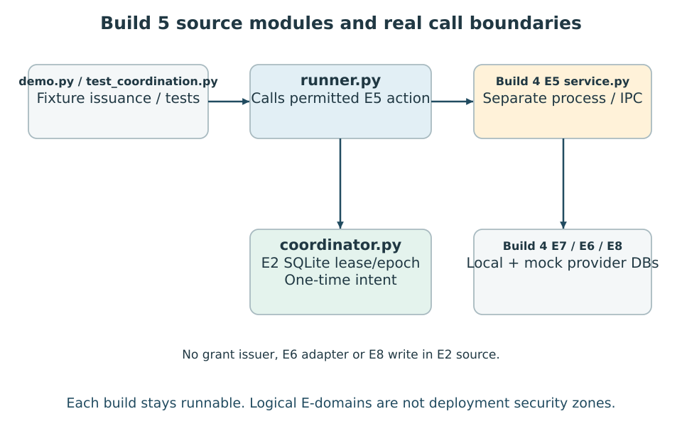

# Build 5 — Optional Coordination and Production Hardening (Chapter 27)

**Educational runnable checkpoint; not a payment service or production coordinator.** Build 5 adds a small durable workflow-ownership subsystem (E2) to the already independently authorized Build 4 trusted-execution service (E5). It does **not** add financial authority, create a new refund identifier, or grant the adviser access to E6/E8. Start with [Chapter 27](../../../manuscript/part-04-implementation/ch27-build-5-optional-coordination-and-production-hardening/index.md), the [companion architecture guide](../ARCHITECTURE.md), [testing matrix](../TESTING.md), and [engineering standard](../ENGINEERING_STANDARD.md).

For the continuing **CASE-204** proposed **$500** refund, the stable consequential-operation identity remains **RF-1042**. E1 is admission and identity, E2 owns work coordination, E5 independently enforces finance authorization, E7 holds operational refund intent, E6 mediates the simulated provider, and mock E8 holds provider-side truth. The C02 assignment boundary is not the C05 trusted financial-action boundary. The C04 advisory proposal has no financial authority. Logical responsibility IDs are not process or security guarantees.

## Actual source/module architecture



| Source | Role | Enforcement and limitation |
|---|---|---|
| `coordinator.py` | Durable E2 lease, monotonic epoch, worker identity, one-time execution intent, case status | `BEGIN IMMEDIATE` and equality/expiry checks protect E2 SQLite mutations only; not E5-side epoch fencing |
| `runner.py` | Selects one `execute`, status-only `reconcile`, or `none`; injects E5 client callable | No issuer key, provider adapter, E7 writes, or E6 access |
| `demo.py` | Launches actual Build 4 E5 subprocess with temporary E1 and finance approval fixture keys; runs scenarios | Fixture harness is **not** an independent real finance issuer or protected deployment |
| `test_coordination.py` | Exercises competing leases, stale writes, crashes, uncertain responses and real E5 subprocess | Tests prove the local SQLite / mock-provider case, not distributed consensus |
| `../build4/service.py` and `../build3/client.py` | Bounded, separately checked E5 IPC with business grant verification | Existing E5 service does **not** check E2 epoch; same-UID processes are not hostile-host isolation |
| `../build4/ledger.py`, `adapter.py` | E7 intent, E6 controlled provider adapter, separate mock E8 store | No settlement, actual payment, remote authorization or real-provider SLA |

**Most important non-guarantee:** Build 5 fences *coordination-state mutations* in E2, not external E5 calls. A stale worker with independently valid finance grant can still attempt to contact E5 directly; E5/E7 have their own authorization and one-time dispatch protections, but E5 does not presently consume/verify the E2 epoch. A real multi-worker production implementation MUST enforce current workflow ownership or an equivalent fencing condition at the trusted consequential boundary, using protected identities and authoritative state. Do not call this demonstration full end-to-end fencing.

## Run from the book root

Python 3.10+ on macOS or Linux with Unix sockets. Standard library only. No external accounts, model, payment API, live provider credentials or customer data.

```sh
cd examples/refund-reference-system/build5
python3 demo.py --scenario approved
python3 demo.py --scenario denied
python3 demo.py --scenario lost-ack
python3 demo.py --scenario outage
python3 -m unittest discover -s . -p 'test_*.py' -v
```

| Scenario | E2 observation | E5 / E7 / mock E8 evidence |
|---|---|---|
| `approved` | `CONFIRMED` | E5 authorizes; one RF-1042 is confirmed against mock provider |
| `denied` | `DENIED` | Valid E1 fixture assertion, missing E5 finance grant; no effect |
| `lost-ack` | `NEEDS_RECONCILIATION` → `CONFIRMED` with epoch 2 owner | E8 commits once; successor uses read-only status lookup, not a second send |
| `outage` | `NEEDS_RECONCILIATION` remains unresolved | E7 dispatch claim exists, E8 has no matching record; NOT_FOUND is not failure proof |

Each demo uses isolated temporary keys, E2/E7/E8 files and E5 socket. The finance approval is minted **only in the local demonstration harness** for a specific, short-lived transaction; the coordinator never has its signing key. The Build 4 fixture's `lose_ack` and `outage_before_send` fields are test-only fault injection and **must not appear in a public payment API**. The demo's E2 time jump simulates a lease takeover, not a real wall-clock delay. It does not test distributed clock skew.

## State and failure rules

1. `READY` can record **one** `EXECUTE_IN_FLIGHT` intent before the first IPC call. Only a current, unexpired lease with the exact epoch can mutate E2 state.
2. Missing, mismatched or malformed E5 confirmation (including wrong operation identity) becomes `NEEDS_RECONCILIATION`; it never authorizes `execute` again. A successor with a larger epoch may call only `reconcile` or escalate.
3. Successful E5 reconciliation may record `CONFIRMED`; a `DENIED` recovery request becomes `ESCALATED`, **not** a claim that the external refund failed. E5 may deny a stale 60-second finance grant.
4. The E2 record is an operational observation, not financial truth. Query the E7 ledger and E8 provider via authorized E5 mechanisms when evidence conflicts.
5. Expiration of a lease does not cancel an already-sent payment operation. The original RF-1042, its one-time E7 dispatch claim and provider idempotency key stay unchanged.

The fixture uses `BEGIN IMMEDIATE`, finite SQLite busy timeout, exact worker syntax, monotonic epochs, explicit connection closure and deterministic test-controlled integer timestamps. It does not implement cross-host clocks, lock-free distributed consensus, preemptive cancellation, sustained worker admission quotas, a durable queue, autonomous retry scheduler, fine-grained observability, redacted centralized audit, malicious same-UID file isolation, independent recovery-service authorization, or multi-region fencing. Those omissions are explicit educational boundaries—not a production recipe. Failure analysis and operational controls continue in Chapters 28–31.

## What readers should test and change

Predict E2, E7 and E8 state after a crash **after E2 writes its intent but before E5 accepts anything**. Explain why safe automated recovery may stop even when no financial effect was observed. Create a valid-token/no-grant attack and confirm E5 remains authoritative. Race eight E2 workers; only one lease can succeed. Take over an expired lease; verify the old owner cannot write, and explain why that does **not** prove it cannot call the unchanged E5 service. Design the additional E5-side current-epoch check and justify its trust root and lease-expiry policy. Compare Build 4's simpler single controller with this optional coordination cost.

**Maintenance standard:** update this README, `architecture.svg`, chapter references, executed test assertions and six-lens evidence in the same patch whenever the E2 state machine, E5 calls or trust boundaries change. Preserve independent runnable Builds 0–4 and verify the edition-specific immutable source tag rather than assuming `main` matches the printed text.
