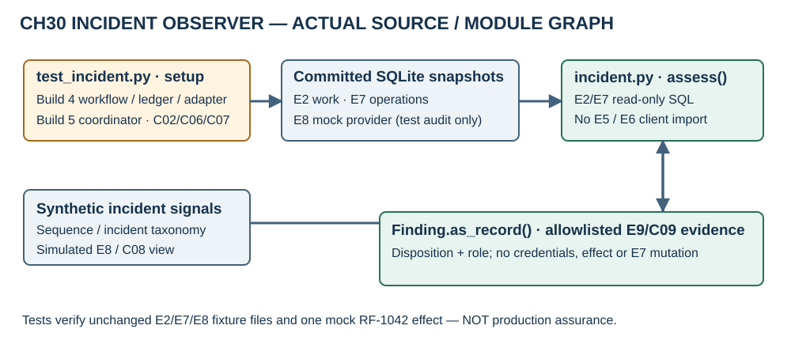

# Chapter 30 — read-only operational incident drill

The Chapter 30 fixture is a **non-progressive observer**, not Build 6. It deliberately **cannot dispatch a payment, authorize RF-1042, change E7 history, call E8, or issue a credential**. It reads committed SQLite snapshots made by **actual Build 4 and Build 5** teaching modules and classifies a separately supplied **synthetic E8 observation** plus ordered incident signals.



## Start here (from the repository root)

```bash
python3 -m unittest discover -s examples/refund-reference-system/operations -p 'test_*.py' -v
```

The suite creates three temporary, fictional local databases via `build4/ledger.py`, `build4/adapter.py`, `build4/workflow.py`, and `build5/coordinator.py`. It **intentionally** uses Build 4's effectful fixture to create a lost acknowledgment *during test setup*: one mock E8 refund exists, while E7 holds `UNKNOWN`. `incident.py` is then called as a separate read-only observer, and the tests compare E2/E7/E8 file digests and provider row counts before and after observation. This proves the observer does not mutate those fixture files in the tested scenarios; it says nothing about real financial settlement or defenses against privileged tampering.

## Source-to-concept map

| Source | Actual responsibility | Reference-architecture mapping | What to inspect |
|---|---|---|---|
| `incident.py` | `Signal`, `ProviderStatus`, `assess`, `_read_one`, `Finding.as_record` | Observes E2/C02, E7/C06, synthetic E8/C08 and E9/C09 | `mode=ro` SQLite connection, strict allowlist, deterministic sequence, no client/adapter import |
| `test_incident.py` | Builds three real local fixtures; injected failures and negative assertions | Reuses Build 4 E5/E6/E7/E8 fixture and Build 5 E2 | `check_read_only`, unknown outcome, provider conflict, token/verifier and stale-epoch cases |
| `../build4/ledger.py` | Durable local E7 intent and transition history | E7/C06 | `prepare`, `claim_dispatch`, `observe_unknown`, `confirm` |
| `../build4/adapter.py` / `workflow.py` | Controlled simulated provider operation and status query | E6/C07, E8/C08 | Test setup only; **never imported by observer** |
| `../build5/coordinator.py` | Local E2 lease, epoch and state | E2/C02 | `initialize`, `acquire`, `mark_execute_intent`, `observe` |
| `../security/test_adversarial_cases.py` | Actual Build 3 E5 adversarial subprocess denial | E1/C01, E3/C04, E5/C05 | Separate Chapter 29 identity-versus-authority evidence |

## Learn by changing one fact at a time

1. Run `test_lost_ack_unknown_with_confirmed_synthetic_e8_still_requires_review`. The observer sees E7 `UNKNOWN`: a synthetic `CONFIRMED` is not permission to close the financial case or replay the payment.
2. Run `test_missing_telemetry_never_closes_case` and `test_out_of_order_signals_have_identical_disposition`. Order is established by **synthetic trusted fixture sequence**, not event arrival; event gaps remain visible.
3. Run `test_stale_epoch_cannot_authorize_action`, `test_revoked_token_quarantines`, and `test_unavailable_verifier_quarantines`. The decision is *human containment and escalation*, not actual token revocation or E5 epoch enforcement.
4. Run `test_local_conflicting_confirmation_history_is_not_erased`. Build 4 retains a prior `CONFIRM` observation when a later conflict puts current E7 into `UNKNOWN`.
5. Read the output schema in `Finding.as_record`. No raw input payload or credential material is logged; event IDs only contain tightly validated safe characters. The tests reject an unsafe event ID and check the rendered record's fixed keys.

## Evidence and guarantees

`Finding` is a **recommendation**, not a command. `READ_ONLY_RECONCILE_OR_ESCALATE` is an explicit allowlisted label, not a functioning reconciliation client. E8 status comes from `ProviderStatus`, a test-only input; even `CONFIRMED` lacks real provider identity, amount, currency, settlement, consistency and retention attestations. The observer only sees current E2/E7 rows, not a distributed atomic snapshot. File digest equality is a scoped local non-mutation check, not an independent protected E9 audit. Separate-process Build 3 E5 is not protected from a same-UID attacker; Build 5 local epochs are **not checked by E5**. No production fault isolation, credential custody, token revocation, provider settlement or exactly-once guarantee is claimed.

**No new progressive build:** Builds 0–5 and their checked-in `architecture.svg` remain unchanged. This directory has its own checked-in source/module architecture SVG because it introduces a new reader-facing test harness. See Chapter 30 Table 30.3, `../IMPLEMENTATION_EVIDENCE_MAP.md`, `../TESTING.md`, and `../ASSURANCE_HANDOFF_CH28_CH31.md`.
