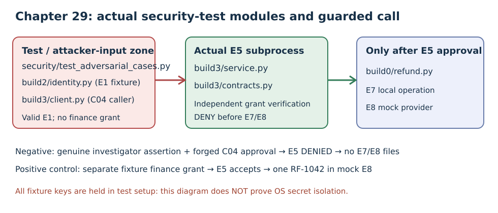

# Chapter 29 adversarial harness — valid token is not finance authority

This is a **non-progressive security test harness** reusing the actual Build 3 E5
Unix-socket subprocess. It is **not Build 6** and does not add another payment
implementation. The test creates a genuine fixture E1 token for the bounded
CASE-204 investigator, then hijacks that request context to attempt a $500
RF-1042 refund **without** an independently issued E5 finance grant.

From the repository root:

```bash
python3 -m unittest discover -s examples/refund-reference-system/security -p 'test_*.py' -v
```

The six tests include a valid-token denial, forged C04 field denial, misuse of
an E1 token as a finance grant, changed operation scope, tampered grant, and a
separately approved positive control. Negative cases inspect both absence of
an E7 `operations.sqlite3` file and absence of a mock E8 `provider.sqlite3`
file, rather than relying only on a status string.

## Source and trust architecture



- `test_adversarial_cases.py` owns test-only identity/finance fixture keys and
  starts the unchanged Build 3 `service.py` subprocess; only that server imports
  the Build 0 refund implementation through its protected executable code.
- `build2/identity.py` issues and verifies the E1 fixture identity assertion.
- `build3/client.py` is the unprivileged request transport used by the harness.
- `build3/contracts.py` independently verifies the test finance grant at E5.
- `build0/refund.py` simulates E7 intent and E8 provider effect, **after** E5
  validates both identity and financial grant.

## What tests establish—and do not

The tests establish that, *in the fixture and given an uncompromised E5 process
and verifier secret*, a genuine E1 investigator token alone does not cause a
local RF-1042 effect. They **do not** prove same-UID OS principal isolation,
real E6 credential secrecy, external provider finality, E5-side E2 epoch
validation, independently protected audit history, or a production separation
of finance approval duties. The harness process holds test fixture keys to
set up the positive control; **there is no adversarial process isolation for
those keys**. The tests emulate adversary-controlled requests, not an actually
sandboxed malicious process. Do not infer security solely from an import graph.

For inherited implementation assumptions, see `../build3/README.md`,
`../build4/README.md`, `../build5/README.md`, and
`../ASSURANCE_HANDOFF_CH28_CH31.md`. Production credential-isolation and
stale-epoch negative tests are explicit future assurance requirements.

## Credential and delegation assurance limits

Chapter 29's credential-lifecycle table distinguishes E1 workload access tokens,
E2 task delegation, E5 finance grants, E6 provider secrets and signing-key
custody. Neither this six-test harness nor its source diagram proves OS-enforced
credential separation, a live revocation service, key rotation, token exchange,
current E2 epoch validation at E5, or independently governed provider egress.
An expired token does not resolve an already ambiguous refund; follow the
original RF-1042 via read-only C08 reconciliation. Chapter 30 must define
containment and incident runbooks; Chapter 31 must collect falsifiable evidence.
